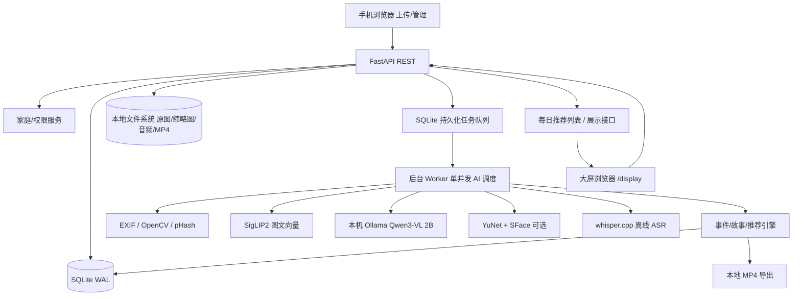

# AI 家庭记忆相册 — 完整产品与工程实现规范（交给 Codex）

> 版本：1.0 | 日期：2026-11-14 | 实施方式：**一次性覆盖全部列明功能，不按产品阶段拆分** | 目标运行环境：Mac mini（优先 Apple Silicon，按约 16GB 统一内存做保守设计）
>
> 产品定位：**主动展示为主的家庭 AI 记忆相框**。手机负责上传、家庭成员管理和纠错；Web 大屏模拟智慧中屏，负责自动播放、故事和轻交互；Mac mini 负责本地存储、照片理解、家庭记忆组织、推荐和可选语音能力。**不依赖第三方在线 AI API，不要求接入电信家庭云，也不要求适配真实中屏硬件。**

## 0. Codex 执行指令（最重要）

你是负责交付可运行完整系统的全栈工程师。请直接在当前工作区实现本规范。**不要仅输出架构建议、伪代码、静态页面或空的模块骨架。**

1. 如果仓库已有代码，先扫描现有目录/依赖/文档，尽可能复用，不得擅自覆盖用户数据；空仓库则按下文初始化。
2. 覆盖本规范的**所有功能**，而非分为 MVP/二期。代码实现可以按依赖关系逐步推进，但最终交付必须在统一验收清单内完成。
3. 实际开发时对模型安装、系统权限、照片样例缺失等条件做能力探测，记录真实状态。**不得声称测试通过但未执行；不得伪造模型运行结果。**
4. 所有外部模型访问封装为 provider，默认本地推理；仅首次安装/下载允许联网。运行时禁止隐式请求第三方在线 API。
5. 对于内存紧张的 Mac，先保证照片服务/推荐/播放始终可用，模型任务入队、单并发、可暂停及重试；AI 故障不能阻止基础相册服务。
6. 产出完整源代码、数据库迁移、安装/启动脚本、`.env.example`、示例数据生成脚本、单元/接口/E2E 测试、README、模型安装指引及当前实际验证结果。
7. 不得导出、上传或提交真实家庭照片、原始人脸特征、访问凭据。测试使用合成/授权样例，不在代码仓库内包含家庭照片。
8. 如存在无法在当前环境验证的硬件/依赖项，保留完整实现与可替换适配层，并在验收报告逐项标记“未验证及原因”，不可用假数据掩盖功能失败。

## 1. 目标、边界和原则

### 1.1 核心目标

- 家庭成员在手机浏览器中登录，**显式选择**照片上传至家庭共享相册。
- 后台对新增照片自动做元数据抽取、去重、质量评价、人脸检测/聚类（须授权）、图像向量、VLM 语义分析、事件整理。
- 自动形成「日常精选、往年今日、旅行、生日/节日、孩子成长、家人新分享」等展示内容，并在大屏空闲页自主播放。
- 支持照片浏览、事件校正、人物命名、手工编辑故事、收藏/不喜欢/隐藏、查询与语音搜索、口述记忆录制与关联。
- 在浏览器中模拟中屏，后续只需适配显示端或存储实现即可迁移，不重写核心业务。

### 1.2 非目标

- 不要求真正连接中国电信家庭云，不做 Android/iOS 原生 APP，不针对智慧中屏 CPU/NPU 做端侧推理。
- 不做视频扩散生成、深度伪造、自动换脸，也不训练大模型；可生成基于真实照片的 MP4 幻灯片。
- 不使用云端人脸识别、云端 LLM、第三方账号登录/云支付。
- 不推断敏感个人身份或亲属关系。人物关系必须由用户填写；“第一次上学”等重要事件必须用户确认或显式记录，不能由模型自作判断。

### 1.3 关键设计原则

1. **主动但不打扰**：大屏仅在空闲/展示模式播放，不抢占用户正在操作的页面；可关闭自动播放、限制时段。
2. **事实优先**：无拍摄时间或地点时标明未知；AI 生成的地点、事件、人物称谓不得直接当作事实。
3. **隐私优先**：上传前明确共享；个人/隐藏照片不进入家庭轮播、故事生成或检索结果；人脸分析和语音处理单独可关闭。
4. **可纠错与可解释**：AI 生成的事件、人物聚类、精选理由可查看并调整；人工修正优先级高于模型重跑。
5. **本地独立**：初次下载模型之后，即使外网断开，也能完成上传、分析、推荐、检索和播放。
6. **模型可替换**：业务层不耦合 Ollama、某个人脸模型、某向量索引或某存储方案。

## 2. 角色、权限和用户旅程

### 2.1 角色

- `owner`：创建家庭空间、邀请/移除成员、配置共享和 AI 开关、管理备份、删除家庭空间。
- `member`：上传/管理自己照片、查看被授权的家庭照片、收藏、编辑自己内容、提供人物与事件修正。
- `viewer`：查看被授权相册/故事、播放和反馈，不可上传或删除。
- `display`：只读展示设备会话，只能读取允许轮播的照片和故事；不能导出原图、访问人脸向量或执行管理操作。

本地验证允许默认创建首位 `owner`，但必须强制设置口令；不允许在源码中写死管理员密码。家庭支持邀请链接/短邀请码（有过期时间和使用次数）。即使当前仅有一个家庭，也需在数据库层保留 `household_id`，避免未来跨家庭泄露。

### 2.2 用户主流程

1. 家庭管理员创建空间并登录 → 配置成员、隐私策略、相框播放时段。
2. 家庭成员手机打开上传页 → 手动选择照片 → 明确勾选“加入家庭共享相册” → 上传并获得可追踪处理状态。
3. 系统立即生成缩略图和基础元数据；AI 任务后台自动执行，不影响照片浏览。
4. 系统把照片整理为事件/人物/时间线，自动推荐每日列表；用户可检查或修正。
5. 大屏 `/display` 在规定时段播放精选、往年今日、故事、节日内容，允许暂停/跳过/收藏/隐藏。
6. 家庭成员可搜索“去年春节的合影”，或按住麦克风说这句话；也可上传一段“这张照片背后的故事”，关联照片/事件。

## 3. 功能需求：每个功能必须真正实现

### F01 家庭与权限管理

- 注册/登录/退出；家庭创建、成员邀请、角色分配、撤销邀请和移除成员。
- 管理员配置家庭名称、时区、展示模式、自动轮播时段、照片默认共享策略（默认非自动共享）。
- 照片访问实行家庭隔离和对象级权限校验；`private` 仅上传者可见，`family` 家庭可见，`hidden` 不得进入自动展示。
- 展示设备通过短期配对码授权，而非复用 owner 凭据；显示端只用低权限会话。

### F02 手机上传和照片管理

- 手机优先响应式 Web：批量上传、拖拽/文件选择、上传进度、失败重试、成功/失败计数、过滤与搜索。
- 文件类型：JPEG、PNG、WEBP、HEIC/HEIF（按实际安装的解码库支持）；拒绝非图片或超限文件并给明确错误。默认单文件 30MB，可配置。
- 原图按 `household_id/photo_id` 放在应用配置数据目录；缩略图至少 320/960 两档；浏览器展示使用低分辨率衍生图。
- 读取 EXIF 拍摄时间/时区/位置/方向；自动处理旋转。缺失 EXIF 时用文件/上传时间作候选，`capture_time_source` 标记来源和不确定性。
- 完全重复：SHA-256；近似重复：pHash + 时间窗口 + 图像相似度，标记可疑重复，由用户决定保留/隐藏；不自动删除原图。
- 批量选择、收藏、隐藏、删除至回收站、回收站恢复、不可逆删除前二次确认；删除应清理缩略图、向量、事件关系及其他派生数据。
- 按时间、事件、人物、上传者、质量状态和可见范围筛选；保留人工标题、说明和拍摄时间校正能力。

### F03 AI 视觉分析

照片导入后异步执行独立步骤，处理状态可见：

1. `metadata`：EXIF、尺寸、格式、哈希、文件校验、缩略图。
2. `quality`：模糊、曝光、过暗/过亮、分辨率、（可选）人脸清晰度，输出 `quality_score` 与理由；质量低仅降低推荐权重，不默认删除。
3. `faces`：默认 **关闭**，家庭管理员明确授权后开启；采用 OpenCV Zoo YuNet 检测、SFace 提取人脸特征，聚类成未知人物候选。**人物姓名/亲属关系只能由用户标注。** 相似度阈值应在家庭样本上校准，不写死“准确率”。
4. `embedding`：使用 SigLIP2 对图片提取 L2 归一化向量；同一模型版本的图像/文本向量需使用匹配的编码器；保存模型名、版本和向量维度。
5. `vlm`：以本机 Qwen3-VL 2B 描述客观可见内容，输出严格 JSON：`scene_tags`, `objects`, `visible_activity`, `candidate_event_type`, `caption`, `confidence`, `uncertainties`。禁止填造姓名、亲属关系、地点、具体日期。
6. `postprocess`：以结构化标签、元数据、向量和用户修正生成可查询的照片索引。

所有步骤要独立记录耗时、成功/失败、模型版本、重试次数；可单张/按批次重跑，且不覆盖人工锁定字段。

### F04 事件聚类与家庭记忆

- 先用拍摄时间接近度创建候选分组，再结合 GPS（如有）、视觉向量和人物共现合并/拆分；不应只依据视觉相似把不同年份或不同活动混在一起。
- 支持事件类型：`travel`, `birthday`, `festival`, `family_gathering`, `outing`, `daily`, `milestone`, `other`。
- 事件字段：标题、起止日期、地点（证据来源）、参与人物、封面、照片列表、简述、类型、置信度、人工确认标记。
- 支持把事件合并、拆分、重命名、重排照片、手动添加/移除照片、切换封面；修正结果不会被下一次自动聚类覆盖。
- 对跨天旅行可形成单个总事件，下含每天片段；无地理信息时依赖时间和视觉证据，不虚构城市。
- “孩子成长”必须先由家庭成员将某人物标为家庭成员并选择“生成成长线”，按年/月、生日、显式里程碑标记组织，不自动宣称“第一次”。

### F05 六类主动展示场景

| 场景 | 触发 | 规则 | 展示形式 |
|---|---|---|---|
| 日常精选 | 每日定时 + 新照片增量 | 质量、人物多样、事件多样、疲劳惩罚 | 10–30 张智能轮播 |
| 往年今日 | 日历日期命中 | 往年同月同日，必要时 ±3 天，明确年份 | “X 年前的今天”卡片 + 照片 |
| 家庭旅行 | 事件达到完整度阈值或手工标记 | 按时间组织、优先选代表照片 | 事件故事幻灯片 |
| 生日/节日 | 家庭登记生日、日历节日、事件识别 | 仅对已确认人物生日/事件启用个性文案 | 节日/生日主题卡片 |
| 孩子成长 | 用户明确指定成长人物 | 年度/月度变化、里程碑优先 | 时间线 + 成长故事 |
| 家人新分享 | 新增家庭共享照片 | 优先展示新上传且未播出的合格照片 | “家人分享了新照片” |

展示必须受照片可见权限、隐藏状态、质量底线、重复控制、家庭时区、免打扰时段限制；缺少候选内容则回退日常精选，不能展示虚构内容。

### F06 推荐引擎（不是随机轮播）

- 所有候选先通过可见性/屏蔽/删除/授权过滤；再按质量和明确的活动证据打分；再进行多样性重排。
- 默认候选来源：最近共享照片、往年今日、历史高价值事件、未充分播放照片、用户收藏、生日/节日确认内容。
- 示例初始权重（可在管理页配置，非真实性能保证）：事件相关 0.25、照片质量 0.20、时间/纪念日相关 0.20、用户偏好 0.15、新鲜度 0.10、历史曝光稀缺度 0.10；均归一化到 [0,1]。
- 在排序后应用 MMR/贪心重排：尽量避免连着出现同一近似画面；单事件默认不超过当日精选的 40%；同一照片最近 7 天播放次数越多，惩罚越大；适度覆盖不同已确认人物，不能仅按人脸数量判断重要性。
- 记录 `playlist_date`, `generated_at`, `config_version`, `photo_id`, `rank`, `score`, `reasons`, `source_scene`, `play_count`。列表生成后保持可回放，可手工重新生成。
- 明确展示推荐理由，如“往年今日”“家人最近上传”“你收藏过的旅行”；不展示无法确认的 AI 猜测。
- 管理页可调整每日数量、播放间隔、轮播类别开关、历史重复窗口、自动展示时间和家庭偏好。
- 反馈：收藏、喜欢、不喜欢、近期不再展示、永久隐藏；即时影响下一次列表生成，并可手工刷新当日列表。

### F07 照片故事 / 家庭纪录片

- 事件形成后可一键生成故事草稿：标题、封面、起止时间、照片顺序、每页说明、结尾；生成文案须基于已知信息。
- 故事可手动编辑：修改标题、文字、照片、顺序、封面、主题、背景颜色、每张时长。
- 故事可在中屏全屏播放，支持自动转场、暂停、跳页、退出、回到轮播。
- 使用本地 FFmpeg 合成 MP4 照片幻灯片（文字字幕可按系统字体能力实现），不需要生成式视频模型；音乐版权素材不得自动抓取。没有可用音轨时导出静音视频。
- 可输出故事 JSON（可重放）、MP4（任务完成后提供下载链接）；生成失败可重试、不会丢失故事草稿。

### F08 搜索、语音搜索与口述记忆

- 搜索框支持人物、标签、事件、时间段、拍摄地点；语义搜索使用 SigLIP2 文本向量与图像向量余弦相似度，叠加结构化过滤。
- 自然语言示例：“去年春节全家合照”“去年去海边的照片”。时间解析基于家庭时区；“全家”仅在用户标记了家庭成员时可提升准确度。
- 声音输入：浏览器录音 → 上传本地 Mac → `whisper.cpp` 多语言模型离线转写（中文）→ 复用文本搜索；UI 显示转写结果并允许修改。不调用浏览器可能依赖云端的 Web Speech API。
- 家庭口述记忆：成员可选择照片或事件录音，保存原音频及转写稿，人工校正文本后以“家庭故事注释”形式展示；可删除录音及转写稿。
- 语音能力依赖模型的安装状态；如果缺失，必须有明确的“尚未安装本地语音模型”提示和本地安装指引，文本搜索不受影响。

### F09 大屏展示体验

- `/display` 是 16:9 横屏优先的全屏 UI，适配 8–10 英寸中屏等比例浏览器，并支持桌面模拟。
- 视图包含：当前照片/事件封面、简短说明、时间信息（如果可信）、类别标识、过渡动画、播放进度；避免文字盖住人脸。
- 播放控制：自动/暂停/前后张/退出、收藏/隐藏反馈、故事详情、点按进入照片详情；键盘快捷键与触摸兼容。
- 空闲自动播放（可配置 30–120 秒）、夜间静默（默认 22:00–07:00 可修改）、照片预加载、断网时显示本地最近缓存列表（不许显示未授权照片）。
- 与管理页分离；`display` 会话对原图/管理员接口没有访问权。

### F10 管理与可观测性

- 上传/分析任务列表与单图状态，失败原因、可重试/暂停/继续、按模型重分析；包含统计：照片总量、事件数、人物簇数、AI 成功率、待处理任务、推荐列表规模、播放次数。
- 设置页：模型运行状态（Ollama、SigLIP2、YuNet/SFace、whisper.cpp、FFmpeg）、本地硬盘空间、数据目录、模型开关、并发限制。
- 数据导出/备份：可导出元数据 JSON + 授权照片文件；支持备份/恢复脚本和数据库完整性校验。
- 提供健康检查、结构化日志、任务耗时统计，日志不含家庭照片原始内容、base64 图片或口述录音正文。

## 4. 页面信息架构与 UI 规范

### 4.1 页面路由（移动端 + 桌面端共用 Web）

| 路由 | 页面 | 核心交互 |
|---|---|---|
| `/setup`, `/login`, `/invite/:code` | 初始化/登录/邀请 | 安全首次建档、家庭成员加入 |
| `/` | 家庭记忆首页 | 今日精选、往年今日、最近事件、新分享、播放入口 |
| `/upload` | 手机上传 | 多选、共享确认、进度和队列状态 |
| `/photos`, `/photos/:id` | 照片库/详情 | 筛选、收藏、隐藏、修改时间说明、查看 AI 识别 |
| `/events`, `/events/:id` | 家庭事件 | 合并/拆分/纠错、生成故事 |
| `/people` | 家庭人物 | 人脸聚类启停、候选确认、命名/合并/拆分 |
| `/timeline` | 成长/家庭时间线 | 选择人物、按年/月查看事件 |
| `/stories`, `/stories/:id/edit` | 故事管理 | AI 草稿、编辑、播放、MP4 导出 |
| `/search` | 文本/语音检索 | 搜索、过滤、结果与声音转写确认 |
| `/display` | 中屏模拟 | 全屏主动轮播、故事播映与反馈 |
| `/settings`, `/jobs` | 设置/任务 | 家庭成员、AI 配置、任务状态、备份 |

### 4.2 交互风格

- 家庭场景：照片是主视觉，暖色/浅色背景，克制动画；不把后台报表放在中屏首页。
- 移动端一屏可完成上传操作；大屏触控目标不小于 44×44 CSS px，适配横屏和夜间模式。
- 空相册、无历史照片、人物未标注、无 GPS、AI 暂不可用、任务失败等状态都要有真实可理解的空态和恢复入口。
- 所有模型标签都与用户手工校正分开显示；在 UI 上清楚标识“AI 推测”“人工确认”。

## 5. 系统架构与技术栈



### 5.1 统一技术选型

- 前端：React + TypeScript + Vite + React Router + TanStack Query；移动/大屏响应式 CSS。需要可靠的表单校验和上传进度。
- 后端：Python 3.11+、FastAPI、Pydantic v2、SQLAlchemy 2、Alembic；`Pillow`、`pillow-heif`、`opencv-python`、`imagehash`、`numpy`、`exifread` 或等价组件。
- 数据：SQLite（WAL、foreign keys、事务与迁移）；图像向量 `float32` BLOB + model/dim/version，针对 1k–3k 张照片先用 NumPy 批量余弦排序，不引入 Milvus/ES。
- 持久队列：以 SQLite `jobs` 表实现租约、幂等键、重试次数、失败退避、服务重启恢复；本机先只启动一个 AI Worker，不需要 Redis/Celery。
- 媒体：本地文件目录 + FFmpeg；只存相对路径，不允许从 API 接收任意文件路径。
- VLM：本机原生 Ollama；模型默认 `qwen3-vl:2b-instruct`（Q4_K_M，约 1.9GB 权重，具体内存使用需实测）；按 API 的图像输入与 JSON 格式输出。
- 图文编码：`google/siglip2-base-patch16-224`，`transformers` + `torch`；优先验证 MPS，失败时自动回退 CPU；推理前/后严格释放内存。模型需保留可替换接口。
- 人脸：OpenCV Zoo YuNet（检测）+ SFace（特征与相似度），聚类可以 HDBSCAN / DBSCAN 或阈值图聚类，须有人工确认流程。商业上线前独立核查所选权重及其训练数据授权。
- STT：`whisper.cpp` 本地 CLI 或服务进程，多语言（非 `.en`）模型；后台异步转写并留有人工校对页。
- 模型下载、版本和许可统一登记在 `MODEL_MANIFEST.md`，固定版本/hash，避免自动升级导致结果变化。

### 5.2 Apple Silicon / 16GB 运行约束

- Ollama **安装运行在 macOS 宿主机**，以便利用 Metal；不要把它放在 Docker Desktop Linux 容器中期待 Apple GPU 加速。
- 项目推荐原生运行前后端和单 Worker，Docker 只作为可选的数据服务/生产迁移配置。若后端在容器中，则通过 `host.docker.internal` 连接本机 Ollama；默认不把 11434 暴露到外网。
- 默认 `VLM_CONCURRENCY=1`、`EMBED_CONCURRENCY=1`、`ASR_CONCURRENCY=1`；重模型不能无约束同时常驻；必要时调低 Ollama keep_alive、按批次加载/卸载 SigLIP2。
- 上传即刻可用，模型分析异步；批量处理可持续很久，必须支持断点继续。不得承诺“3000 张几分钟处理完”等无基准的速度。
- 指标不是追求模型最高吞吐，而是保证 1–3 千张家庭照片的功能正确性、持续运行与数据一致性。

### 5.3 模块接口

定义 Python Protocol/抽象类：

- `StorageProvider`: `put_original`, `read_media`, `create_derivative`, `delete_media`, `generate_signed_or_authorized_url`。
- `ImageEmbeddingProvider`: `embed_image`, `embed_text`, `version`, `dimension`。
- `VisionUnderstandingProvider`: `analyze_photo -> PhotoAnalysisSchema`，验证 JSON，失败重试。
- `FaceProvider`: `detect_faces`, `embed_faces`, `cluster_faces`；授权关闭时不运行。
- `SpeechToTextProvider`: `transcribe(audio, language='zh')`。
- `RecommendationService`: `build_daily_playlist(household_id, date, config)`。

要求具备真实 provider + 可用于单测的 fake provider，不允许生产路径静默使用 fake provider。

## 6. 数据模型（必须有迁移和关系约束）

以下为核心表，类型和索引由开发按 SQLite 适配细化。

| 表 | 最少字段与约束 |
|---|---|
| `households` | id, name, timezone, created_at, settings_json |
| `users` | id, display_name, password_hash, created_at |
| `memberships` | household_id, user_id, role, status, unique(household_id,user_id) |
| `invitations` | household_id, token_hash, role, expires_at, max_uses, used_count |
| `display_devices` | household_id, token_hash, name, paired_at, revoked_at |
| `photos` | id, household_id, uploader_id, storage_key, sha256, phash, mime, width, height, taken_at, capture_time_source, gps_lat, gps_lon, visibility, is_hidden, is_deleted, title, caption_user, created_at |
| `photo_derivatives` | photo_id, variant, storage_key, width, height, status |
| `photo_analyses` | photo_id, model_name/version, pipeline_version, tags_json, caption_ai, confidence_json, quality_score, quality_reasons_json, status, updated_at |
| `embeddings` | photo_id, model_id, model_version, dimension, data_blob, created_at, unique(photo_id,model_version) |
| `people` | id, household_id, name_nullable, relationship_nullable, consent_flag, manually_confirmed |
| `faces` | id, photo_id, person_id_nullable, bounding_box_json, embedding_blob_optional, quality, cluster_id, status |
| `events` | id, household_id, title, event_type, start_at, end_at, location_label, location_source, summary, cover_photo_id, confirmed, revision |
| `event_photos` | event_id, photo_id, position, source, unique(event_id,photo_id) |
| `milestones` | id, household_id, person_id, date, title, note, confirmed |
| `stories` | id, household_id, event_id_nullable, title, theme, status, version, created_by, generated_by_ai, mp4_key_nullable |
| `story_slides` | story_id, photo_id, position, duration_s, caption, transition |
| `audio_memories` | id, household_id, photo_id_nullable, event_id_nullable, uploader_id, audio_key, transcript, transcript_confirmed, created_at |
| `playlists` | id, household_id, playlist_date, generator_version, config_json, created_at |
| `playlist_items` | playlist_id, photo_id_nullable, story_id_nullable, position, score, reason_codes_json, scene_type |
| `playback_events` | household_id, display_device_id, photo_id/story_id, played_at, dwell_seconds, action |
| `feedback` | household_id, actor_id, photo_id/event_id, type, created_at |
| `jobs` | id, household_id, target_type, target_id, job_type, state, priority, attempts, max_attempts, lease_until, next_run_at, error_code, error_message_sanitized, idempotency_key, created_at, updated_at |
| `audit_logs` | household_id, actor_id, action, object_type, object_id, time, metadata_sanitized |

要求 `photos(household_id, taken_at)`、`events(household_id,start_at)`、`jobs(state,next_run_at)` 等关键索引；保证关联删除、跨家庭隔离和用户删除语义。向量和人脸特征应分别可删除；照片被私密化后必须立即从推荐候选排除，不能等下一次异步分析。

## 7. 核心算法与数据契约

### 7.1 照片分析输出

严格使用 Pydantic 校验 JSON（字段缺失时允许合理缺省，不能填造）。示例结构：

```json
{
  "scene_tags": ["户外", "海边"],
  "objects": ["沙滩", "海水"],
  "visible_activity": "几个人站在海边合影",
  "candidate_event_type": "travel",
  "caption": "几个人在海边合影",
  "confidence": 0.71,
  "uncertainties": ["无法确认人物姓名", "无法确认拍摄地点"]
}
```

不要因为 VLM 输出“孩子在过生日”就把它自动标注为**某人的真实生日**；仅保留候选事件，人工确认后才用于生日提醒。

### 7.2 事件聚类建议

- 优先按时间生成候选组：短间隔照片可能同一活动；跨天相似地点/人物/视觉主题作为旅行合并候选。
- 阈值配在 `config` 中，提供样本标注/管理界面；聚类结果每次重跑留下 revision，人工锁定事件不自动覆盖。
- 聚类应考虑缺失时间、跨年同场景、照片来源上传时间与实际拍摄时间不一致等情况。
- 同一照片允许属于多个“主题集合”，但日历事件有主事件关系；故事播放按选定集合展示。

### 7.3 推荐伪代码（必须实现等价可测试逻辑）

```python
candidates = eligible_family_photos(household_id)  # 权限、隐藏、回收站、屏蔽
scores = normalized_weighted_score(candidates, features={
    "event_relevance": .25,
    "quality": .20,
    "calendar_relevance": .20,
    "user_preference": .15,
    "freshness": .10,
    "underexposure": .10,
})
ranked = diversify_mmr(scores,
    same_image_penalty=True,
    near_duplicate_penalty=True,
    max_event_fraction=.40,
    recent_playback_lookback_days=7,
)
playlist = ranked[:settings.daily_photo_limit]
persist_playlist_with_reason_codes(playlist)
```

- 以上为**初始化规则**，不是经过用户验证的最优权重；通过用户反馈再调整。
- 对少于 10 张可播放照片的家庭，不人为重复凑数；可维持小列表并给上传提示。
- 推荐必须可重现：相同输入数据、日期、配置版本和随机种子返回相同顺序。

### 7.4 语义搜索

- 结构化过滤优先：年月/节日/人物/事件/地点为过滤条件，SigLIP2 文本向量负责模糊相关排序。
- 显示匹配原因和未知条件；中文自然语言时间解析要覆盖“去年”“上个月”“春节”等基础表达，不把历史年份错当上传时间。
- 如果未命中，不造结果；提供放宽条件和普通文本标签搜索。

## 8. REST API 契约（建议统一 `/api/v1`）

| 方法与路径 | 说明 |
|---|---|
| `POST /auth/setup`, `/auth/login`, `/auth/logout`, `GET /auth/me` | 首次设置/会话登录 |
| `GET/POST /households`, `GET/PATCH /households/{id}` | 家庭配置 |
| `POST /households/{id}/invites`, `POST /invites/{code}/join` | 邀请成员 |
| `GET /households/{id}/members`, `PATCH/DELETE /members/{id}` | 成员管理 |
| `POST /photos/upload`, `GET /photos`, `GET/PATCH/DELETE /photos/{id}` | 上传、查询、编辑/回收站 |
| `GET /photos/{id}/media/{variant}` | 权限校验后的媒体读取 |
| `POST /photos/{id}/restore`, `/photos/{id}/analyze`, `/photos/{id}/feedback` | 恢复/重分析/反馈 |
| `GET /people`, `PATCH /people/{id}`, `POST /people/merge`, `POST /people/split` | 人物管理 |
| `GET /events`, `GET/PATCH /events/{id}`, `POST /events/merge`, `POST /events/{id}/split` | 事件管理 |
| `GET /timeline`, `POST/PATCH /milestones` | 成长时间线 |
| `POST /stories/generate`, `GET /stories`, `GET/PATCH /stories/{id}` | 故事生成编辑 |
| `POST /stories/{id}/export`, `GET /stories/{id}/export` | MP4 异步导出/下载 |
| `POST /search` | 文本 + 过滤条件搜索 |
| `POST /speech/transcribe` | 音频本地识别 |
| `POST /memories/audio`, `GET/PATCH/DELETE /memories/audio/{id}` | 口述记忆 |
| `GET /playlists/today`, `POST /playlists/regenerate`, `GET /playlists/{date}` | 自动推荐播放列表 |
| `POST /display/pair`, `GET /display/feed`, `POST /display/events` | 大屏授权、只读播放、播放记录 |
| `GET /jobs`, `POST /jobs/{id}/retry`, `POST /jobs/pause`, `POST /jobs/resume` | 任务控制 |
| `GET /system/health`, `GET /system/models`, `GET/PATCH /settings` | 运维和配置 |

- 用 OpenAPI 自动生成接口文档和 TypeScript 客户端类型；统一错误结构 `code/message/details/request_id`。
- 所有列表支持分页，时间戳使用 ISO 8601 + 时区；统一服务端权限检查，不靠隐藏按钮防越权。
- 上传返回 `photo_id`、`job_id`、`status`；AI 与 MP4 等耗时任务返回可查询 Job，不阻塞 HTTP 请求。
- 公开展示终端只读端点只能读已授权的派生图，不提供原始图的无限期直链。

## 9. 任务调度、失败恢复与 AI 使用策略

- `photo_uploaded` → `generate_thumbnails` → `extract_metadata` → `quality` → `embedding` → `vlm` → `face_optional` → `event_update` → `recommendation_refresh`。
- 每个任务都可重复执行且幂等，失败区分：可重试模型连接超时/内存不足/文件临时锁，与永久失败不支持格式/损坏文件。
- 单 worker 依赖数据库租约领取任务；重启扫描过期 lease 并恢复，不会双重更新照片。
- 定时每天在家庭当地时间 04:00 生成新列表（可配置），照片上传后可触发增量重排；仅在展示端空闲周期切换播放列表，避免正在播放时突变。
- VLM 只作用于缩放后的合理尺寸照片，不把完整原图重复送入模型；输出 JSON 后进行 schema 校验、异常值过滤和有限重试。
- 开启人脸功能前先展示授权弹窗；关闭时暂停后续人脸任务，并提供彻底删除已存生物特征数据的操作。

## 10. 目录布局（建议）

```text
ai-family-album/
  README.md
  CODEX_SPEC.md                 # 本文件可复制进项目
  .env.example
  pyproject.toml
  package.json                 # 根目录快捷脚本/或 Makefile
  Makefile
  apps/
    api/
      app/
        main.py
        core/                  # settings/auth/security/logging
        db/                    # models/migrations/repositories
        api/                   # routers + schemas
        services/              # photos/events/stories/search/recommendations
        ai/                    # providers/prompts/pipelines
        workers/               # scheduler/jobs/lease/retry
      tests/
    web/
      src/
        pages/
        components/
        hooks/
        api/
        styles/
      tests/
  scripts/
    setup_macos.sh
    download_models.sh
    bootstrap_admin.py
    create_sample_library.py
    backup.sh
    restore.sh
    smoke_test.sh
  models/                      # 模型放这里或共享缓存，不提交权重
  data/                        # 不提交：数据库/原图/衍生图/音频/导出
  docs/
    API.md
    MODEL_MANIFEST.md
    DEPLOY_MAC.md
    OPERATIONS.md
    TEST_REPORT.md
  .gitignore
```

目录可根据现有代码调整，但职责应明确；`data`、模型权重、密钥和私人照片必须在 `.gitignore`，版本库中不得存照片样例的个人数据。

## 11. 配置示例与启动流程

`.env.example` 至少包含：

```dotenv
APP_ENV=development
APP_HOST=127.0.0.1
APP_PORT=8000
WEB_PORT=5173
DATA_DIR=./data
DATABASE_URL=sqlite:///./data/album.sqlite3
DEFAULT_HOUSEHOLD_TIMEZONE=Asia/Shanghai
OLLAMA_BASE_URL=http://127.0.0.1:11434
VLM_MODEL=qwen3-vl:2b-instruct
SIGLIP_MODEL=google/siglip2-base-patch16-224
MAX_UPLOAD_MB=30
VLM_CONCURRENCY=1
EMBED_CONCURRENCY=1
ASR_CONCURRENCY=1
ENABLE_FACE_ANALYSIS=false
DAILY_PHOTO_LIMIT=20
DISPLAY_INTERVAL_SECONDS=10
DISPLAY_QUIET_START=22:00
DISPLAY_QUIET_END=07:00
SESSION_COOKIE_SECURE=false
```

- 开发缺省绑定 `127.0.0.1`；手机局域网访问需显式配置监听地址、防火墙和可信 LAN，并开启 HTTPS 或安全网关；不能简单把敏感照片服务暴露到互联网。
- `scripts/setup_macos.sh` 检测 Homebrew / Python / Node / FFmpeg / Ollama，提供明确安装路径。安装失败不得继续伪装成功。
- `scripts/download_models.sh` 获取 VLM、SigLIP2、YuNet/SFace、whisper.cpp 中文多语言模型（按选择下载），校验版本和哈希。
- `make setup`, `make dev`, `make worker`, `make test`, `make smoke`, `make backup` 均应有真实可运行实现，并在 README 解释是否需要多个终端。
- 至少支持：① 无 AI 模型时浏览/上传/播放；② 模型安装齐全后自动分析；③ 断网环境功能验证。

## 12. 安全、隐私与治理要求

- 不自动扫描用户手机相册；不默认向所有家庭成员共享私人内容。家庭成员需要逐次或按明确范围授权上传。
- 默认不处理生物特征。提供人脸识别告知与同意、人工确认身份、撤回授权、删除特征、儿童数据特别提示。
- `password_hash` 使用 Argon2id 等安全算法；会话 Cookie `HttpOnly`, `SameSite`，生产 HTTPS 设置 `Secure`；会话 CSRF 防护、登录限流、邀请码过期及撤销。
- 拦截路径遍历/软链接逃逸/恶意伪造 MIME/超大像素解压炸弹；文件先写临时目录、校验解码，再原子转移。
- 防止 URL 越权：**任意照片/故事/录音/显示 API 必须通过 `household_id` 和角色访问控制**。生成的缩略图不能使用公共静态目录绕过授权。
- 对日志、错误栈、数据库备份中可能出现的图片描述/人脸特征进行适当脱敏和权限控制。
- 备份和导出要有明确授权；默认不开启外网远程访问，后续商业化需另行做法律、数据安全与许可审查。

## 13. 测试要求与全量验收标准

**以下是目标标准，不代表已经实测。Codex 必须报告实际结果。**

### 13.1 自动化测试

- 后端：pytest 测试家庭权限、上传校验、哈希去重、EXIF 缺失、时间区间、隐私过滤、任务幂等/重试、事件锁定、推荐得分与多样性、搜索结构化过滤、模型 JSON 异常、删除级联。
- 前端：Vitest/React Testing Library 验证上传状态、管理权限、无数据空态和播放状态；Playwright E2E 验证完整主流程。
- 集成：提供不依赖外网的合成图片集和已知事件元数据，验证上传→分析 mock→事件→推荐→展示→反馈；再单独执行真实模型冒烟测试。
- 性能：对 1000/3000 张本地测试样例测量导入、占用内存、处理吞吐、单次推荐用时、播放首屏时间；不得把模拟模型吞吐当真实推理性能。

### 13.2 用户验收案例（全部必过）

1. 创建家庭空间，邀请第二成员登录，并上传 100 张照片；两名成员可看到**被显式共享**内容。
2. 上传相同文件两次，系统识别完全重复；相似连拍进入近似重复候选组，原图不会被自动删除。
3. 上传含/不含 EXIF 的照片，时间/地点展示正确或明确未知，自动旋转正确。
4. 启用本地模型后，新增照片能自动生成视觉标签、自然语言简述、向量及质量分；任务状态与失败可重试。
5. 将若干旅行和生日样例照片整理成事件；用户可以拆分/合并且下次重算不覆盖人工修正。
6. 关闭人脸功能时无新增人脸特征；开启并同意后可检测、聚类、命名，误聚类可拆开。
7. 家庭具有往年同日照片时出现“往年今日”；没有时不制造回忆。
8. 登记孩子成长人物与生日后，能按年份生成成长线，并自动展示已确认生日相关照片。
9. 新成员上传照片，管理页出现新分享，自动播放列表可更新；隐藏/私密内容**绝不出现在展示页**。
10. 生成每日 10–30 张精选（照片不足则按实际），能看推荐理由，且不会连续重复同一张/近似同一张。
11. 收藏、不喜欢、暂停展示后，刷新列表排序/过滤能体现反馈，播放记录落库。
12. 事件生成照片故事草稿、可编辑并全屏播放，可本地导出 MP4 并下载。
13. 文本搜索“去年春节”“海边合照”能依据时间与图片信息找到候选，并标示结果依据；无匹配时给空结果。
14. 通过本机语音模型转写一段中文查询并搜索；录制一段口述记忆并绑定照片，文本可修改/删除。
15. `/display` 支持全屏、自动播放、暂停、前后切换、无数据空态、静默时段、展示账户最小权限。
16. Mac mini 重启后，数据库、照片、故事和完成任务仍在；未完成任务可安全恢复，不重复创建数据。
17. 在断网且模型已安装的情况下完成照片分析、搜索和展示；无法联网不会触发第三方 AI 请求。
18. 尝试跨家庭访问其他人的原图/缩略图/录音/API，全部拒绝并留下合理审计；撤回共享后展示端立即不可见。
19. 自动化测试、静态检查和前后端构建能执行；README 中列出实际通过/失败项目以及运行命令。

### 13.3 建议记录的质量指标（只作为评价目标）

- 有效导入率、分析失败率、事件聚类的人工纠正次数、推荐内容被收藏/跳过率、近重复曝光率。
- 手工标注至少 100 张样本，评估场景标签准确性与关键事件识别；报告误报/漏报，而非只展示模型能力演示。
- 人脸识别在不具备授权数据/样本时不宣称高准确率，误识别风险由人工确认流程兜底。
- 真实 Mac 上记录峰值内存与模型加载卸载行为；优先完成稳定闭环，再根据测量优化性能。

## 14. Codex 完成后必须交付的内容

1. **可运行应用**：手机上传端、管理端、中屏模拟端、API、Worker、数据存储、模型 provider、故事导出和本地语音。
2. **运行说明**：从空 Mac 环境安装依赖、下载模型、初始化账号、启动服务、手机访问、进入 `/display` 的逐条命令。
3. **数据说明**：完整数据库迁移、目录权限、备份与恢复、删除及隐私策略。
4. **工程质量**：至少一套本地无需家庭照片的示例数据和端到端测试，模型可 mock，真实模型另有冒烟测试。
5. **最终验证报告**：已实现功能、实际运行结果、没能验证的功能、已知缺陷、真实模型下载体积、资源测量与风险；不得把“待实现”写成“已完成”。

## 15. 参考资料（选型依据，开发时应按官方文档复核）

- Qwen3-VL 2B Ollama 模型（包含模型标签与最低 Ollama 版本说明）：https://ollama.com/library/qwen3-vl:2b-instruct
- Ollama 视觉图像输入规范：https://docs.ollama.com/capabilities/vision
- Ollama 本地 API 文档：https://docs.ollama.com/api
- SigLIP2 模型卡和许可：https://huggingface.co/google/siglip2-base-patch16-224
- SigLIP2 Transformers 文档：https://huggingface.co/docs/transformers/model_doc/siglip2
- OpenCV Zoo YuNet 人脸检测：https://github.com/opencv/opencv_zoo/tree/main/models/face_detection_yunet
- OpenCV Zoo SFace 特征提取：https://github.com/opencv/opencv_zoo/tree/main/models/face_recognition_sface
- whisper.cpp Apple Silicon + Metal 本地 ASR：https://github.com/ggml-org/whisper.cpp
- FFmpeg 本地视频导出：https://ffmpeg.org/documentation.html

---

**最终产品要求：这是一套“家庭成员上传 → 本地 AI 理解 → 事件/成长记忆组织 → 每日主动推荐 → 智慧中屏模拟播放 → 搜索/故事/反馈纠错”的完整 AI 家庭记忆相册。不要把方案简化成静态照片轮播，也不要因为一台 Mac mini 的算力有限而删掉功能；应通过异步任务、模型卸载、可降级和完整测试保障可用。**
